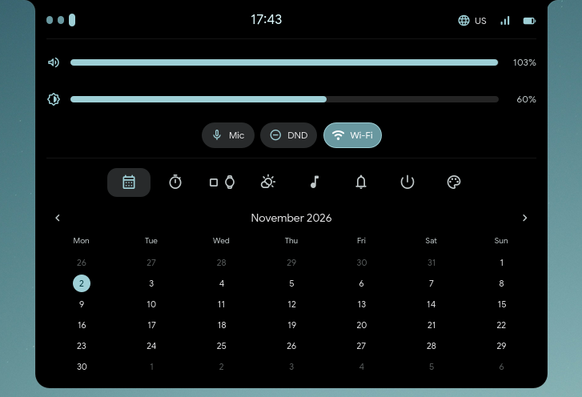
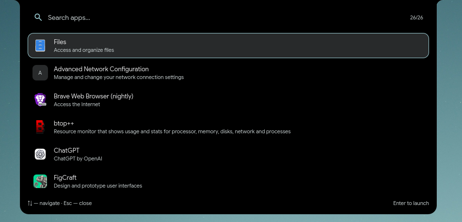
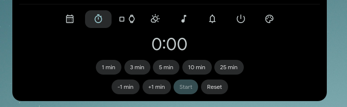
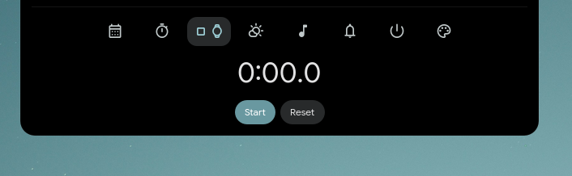
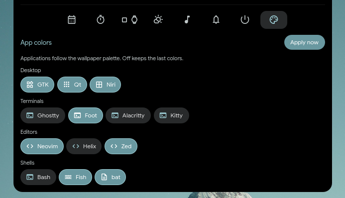
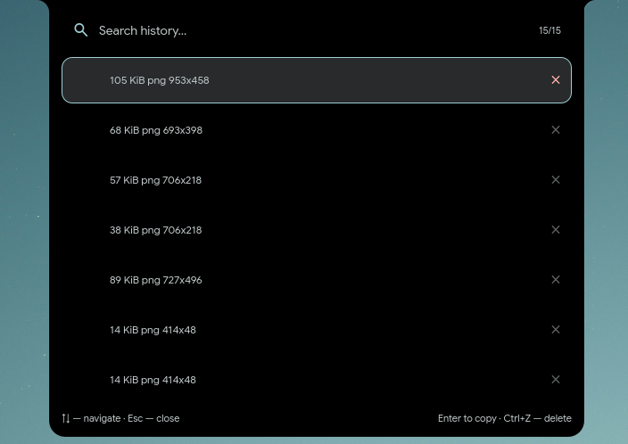
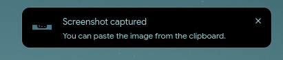
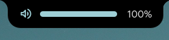
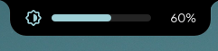
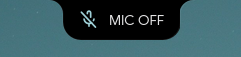

# quickshell-modern

A compact, OLED-black desktop shell for [niri](https://github.com/YaLTeR/niri), built with
[Quickshell](https://quickshell.org/). The top bar grows into a launcher, control center,
wallpaper picker and clipboard history, while [matugen](https://github.com/InioX/matugen)
keeps the whole desktop in sync with the wallpaper.




## Features

- **Peninsula bar** — a compact plate pinned to the top edge, with concave flare wings
  that blend it into the screen. Workspace pills, a centered clock, keyboard layout,
  network state and a battery pill.
- **One surface, many panels** — the bar morphs into the launcher, quick settings,
  wallpaper ribbon or clipboard picker on the monitor you target. `Esc`, the scrim or a
  click outside closes the open panel.
- **Launcher** — fuzzy matching across application names, keywords and comments, with
  results ranked by launch frequency and persisted launch counts. Applications marked
  `Terminal=true` run through `$TERMINAL` (defaults to `alacritty`).
- **Control center** — volume and brightness sliders, Mic / DND / Wi-Fi / Bluetooth chips,
  and tabs for calendar, timer, stopwatch, weather, media, notifications, power and app
  colors.
- **Wi-Fi management** — scanned networks and saved profiles via `nmcli`, including
  connect, disconnect, forget and password entry.
- **Notifications** — a notification server with popup toasts, DND, actions, critical
  notifications and a scrollable history in the control center.
- **Clipboard history** — browse, re-copy and delete `cliphist` entries with the keyboard
  or mouse.
- **Wallpapers** — a thumbnail ribbon of `~/Pictures/Wallpapers`, plus desktop drag-and-drop
  for new images.
- **OSD** — volume, brightness, microphone, Caps Lock and keyboard-layout changes replace
  the bar content for a moment.
- **Live theming** — matugen's Material palette is applied to GTK, Qt, niri, terminals,
  editors and shells, and the shell itself recolors as soon as `style/Colors.json` changes.
- **Multi-monitor aware** — every screen gets its own bar; panels open on the monitor they
  were requested for.

## Screenshots

| | |
|:--:|:--:|
| <br><sub>**Bar** — workspace pills, clock, layout, network and battery</sub> | <br><sub>**Launcher** — fuzzy search and launch-frequency ranking</sub> |
| <br><sub>**Timer** — presets, ±1 minute, pause and reset</sub> | <br><sub>**Stopwatch** — survives closing the panel</sub> |
| <br><sub>**App colors** — per-application theme targets</sub> | <br><sub>**Clipboard** — history with decode, copy and delete</sub> |
| <br><sub>**Notification** — toast with actions and DND support</sub> | <br><sub>**Caps Lock OSD**</sub> |
| <br><sub>**Volume OSD**</sub> | <br><sub>**Brightness OSD**</sub> |
| <br><sub>**Microphone OSD**</sub> | |

## Requirements

- **niri** — workspaces, keyboard layouts, focused-output targeting and power actions use
  `niri msg` IPC.
- **Quickshell 0.3.2+** with Qt 6 and layer-shell support.
- **matugen** — generates the Material palette from the wallpaper. The shell has a fallback
  palette and still works without it.
- **awww** — wallpaper daemon used by the picker and desktop drop. `awww img` and
  `awww query` must work.
- **cliphist** and **wl-clipboard** — clipboard storage.
- **brightnessctl** — backlight control.
- **NetworkManager** (`nmcli`) — network status and Wi-Fi management.
- **BlueZ** (`bluetoothctl`) — Bluetooth state and toggling.
- **PipeWire + WirePlumber** and `pactl` (from `libpulse`) — audio state and volume control.
- **curl** — weather data from `api.open-meteo.com` (location via `ipwho.is`).
- **Google Sans** and **Material Symbols Rounded** — the default UI fonts.
- Optional: **jq** for focused-output keybinds, **bat** for the bat color target.

On Arch Linux, the core packages are:

```bash
sudo pacman -S --needed quickshell niri matugen cliphist wl-clipboard \
  brightnessctl networkmanager bluez-utils wireplumber libpulse curl jq \
  ttf-material-symbols-variable
```

Install `awww` separately (package or local build), and place `GoogleSans.ttf` in
`~/.local/share/fonts` before running `fc-cache -f`. If you do not want Google Sans,
change `fontFamily` in `style/Theme.qml`.

## Installation

Clone the configuration into the default Quickshell location:

```bash
git clone https://github.com/cactozs/quickshell-modern.git ~/.config/quickshell
```

Start the shell for the current session:

```bash
qs
```

QuickShell discovers `~/.config/quickshell/shell.qml` automatically. To start it with niri,
add the following to `~/.config/niri/config.kdl` (or an included file):

```kdl
spawn-at-startup "awww-daemon"
spawn-at-startup "sh" "-c" "wl-paste --type text --watch cliphist store"
spawn-at-startup "sh" "-c" "wl-paste --type image --watch cliphist store"
spawn-at-startup "env" "QT_QUICK_BACKEND=software" "quickshell"
```

`QT_QUICK_BACKEND=software` keeps the shell on Qt's software renderer and avoids loading the
GPU stack just for the bar. Remove it if you prefer hardware rendering.

## Keybinds

The shell exposes its actions over IPC. Bindings live in your niri config, not in this
repository. These are the bindings used by the reference setup:

```kdl
binds {
    Mod+A repeat=false hotkey-overlay-title="Launcher" {
        spawn-sh "qs ipc call launcher toggleOn $(niri msg --json focused-output | jq -r .name)";
    }
    Mod+V repeat=false hotkey-overlay-title="Clipboard" {
        spawn-sh "qs ipc call clipboard toggleOn $(niri msg --json focused-output | jq -r .name)";
    }
    Mod+Ctrl+W repeat=false hotkey-overlay-title="Wallpaper" {
        spawn-sh "qs ipc call wallpaper toggleOn $(niri msg --json focused-output | jq -r .name)";
    }
    Mod+N repeat=false hotkey-overlay-title="Notifications" {
        spawn-sh "qs ipc call notifs toggleOn $(niri msg --json focused-output | jq -r .name)";
    }
    Mod+Shift+N repeat=false hotkey-overlay-title="Toggle Do Not Disturb" {
        spawn "qs" "ipc" "call" "notifs" "toggleDnd";
    }
    Mod+P repeat=false hotkey-overlay-title="Toggle Bar" {
        spawn "qs" "ipc" "call" "bar" "toggle";
    }
}
```

Clicking empty space on the bar opens quick settings. You can also bind it directly:

```kdl
Mod+S repeat=false hotkey-overlay-title="Quick settings" {
    spawn-sh "qs ipc call quicksettings toggleOn $(niri msg --json focused-output | jq -r .name)";
}
```

## IPC

All panel state can be driven with `qs ipc call <target> <function> [args...]`:

| Target | Function | Description |
| --- | --- | --- |
| `bar` | `toggle` | Hide or show the bar on every output |
| `launcher` | `toggle` / `toggleOn <screen>` / `close` | Open, open on a specific output, or close |
| `quicksettings` | `toggle` / `toggleOn <screen>` / `close` | Open, open on a specific output, or close |
| `quicksettings` | `openTab <screen> <index>` | Open the panel on a specific tab |
| `clipboard` | `toggle` / `toggleOn <screen>` / `close` | Clipboard history |
| `wallpaper` | `toggle` / `toggleOn <screen>` / `close` | Wallpaper ribbon |
| `wallpaper` | `set <path>` / `refresh` | Apply a wallpaper / rescan the collection |
| `notifs` | `toggle` / `toggleOn <screen>` / `close` | Notification center (quick settings notifications tab) |
| `notifs` | `clearAll` / `toggleDnd` / `listActive` | Clear history, toggle DND, list active summaries |
| `systemtheme` | `apply` | Rewrite every enabled application theme now |
| `systemtheme` | `setApp <id> <enabled>` | Enable or disable an app color target |

Quick settings tab indexes:

| Index | Tab |
| --- | --- |
| `0` | Calendar |
| `1` | Timer |
| `2` | Stopwatch |
| `3` | Weather |
| `4` | Media |
| `5` | Notifications |
| `6` | Power |
| `7` | Wi-Fi networks |
| `8` | App colors |

Examples:

```bash
qs ipc call quicksettings openTab "" 5
qs ipc call wallpaper set "$HOME/Pictures/Wallpapers/mountain.png"
qs ipc call systemtheme setApp ghostty false
```

An empty screen argument keeps the last used output, or falls back to the first output.

## Theming

The shell's palette comes from `style/Colors.json`, which matugen generates from the active
wallpaper. The file is gitignored; `style/Theme.qml` contains matching fallback values so a
fresh checkout still looks right. When the file changes, the shell watches it and recolors
live.

For the usual wallpaper-to-theme flow, make `awww img` regenerate the palette. The
reference setup puts a small shim at `/usr/local/bin/awww` (earlier in `PATH` than the real
binary):

```sh
#!/bin/sh
# Only plain `awww img <existing-file>` is intercepted. Everything else
# (query/restore/pause, extra flags, colors, stdin) reaches the real binary.
if [ "$#" -eq 2 ] && [ "$1" = img ] && [ -f "$2" ]; then
    matugen image "$2" && exit 0
fi
exec /usr/bin/awww "$@"
```

`~/.config/matugen/config.toml` must set the wallpaper with the real binary (so the shim
does not recurse) and write the template into this repository's `style/Colors.json`:

```toml
[config]
version_check = false
source_color_index = 0
fallback_color = "#6750A4"

[config.wallpaper]
set = true
command = "/usr/bin/awww img --transition-type center \"{{ image }}\""

[templates.quickshell]
input_path = "/home/you/.config/matugen/templates/quickshell.json"
output_path = "/home/you/.config/quickshell/style/Colors.json"
type = "SchemeContent"
```

The template maps Material color roles onto JSON keys; `Theme.qml` reads at least these:

```json
{
  "primary": "{{colors.primary.default.hex}}",
  "on_primary": "{{colors.on_primary.default.hex}}",
  "primary_container": "{{colors.primary_container.default.hex}}",
  "on_primary_container": "{{colors.on_primary_container.default.hex}}",
  "secondary": "{{colors.secondary.default.hex}}",
  "on_secondary": "{{colors.on_secondary.default.hex}}",
  "tertiary": "{{colors.tertiary.default.hex}}",
  "on_tertiary": "{{colors.on_tertiary.default.hex}}",
  "error": "{{colors.error.default.hex}}",
  "on_error": "{{colors.on_error.default.hex}}",
  "error_container": "{{colors.error_container.default.hex}}",
  "surface": "{{colors.surface.default.hex}}",
  "on_surface": "{{colors.on_surface.default.hex}}",
  "on_surface_variant": "{{colors.on_surface_variant.default.hex}}",
  "surface_container_lowest": "{{colors.surface_container_lowest.default.hex}}",
  "surface_container_low": "{{colors.surface_container_low.default.hex}}",
  "surface_container": "{{colors.surface_container.default.hex}}",
  "surface_container_high": "{{colors.surface_container_high.default.hex}}",
  "surface_container_highest": "{{colors.surface_container_highest.default.hex}}",
  "outline": "{{colors.outline.default.hex}}",
  "outline_variant": "{{colors.outline_variant.default.hex}}",
  "inverse_surface": "{{colors.inverse_surface.default.hex}}",
  "inverse_on_surface": "{{colors.inverse_on_surface.default.hex}}",
  "shadow": "{{colors.shadow.default.hex}}"
}
```

Extra keys are ignored, so you can extend the template with the rest of the Material
palette. The shell itself watches `style/Colors.json`; no Quickshell restart or post-hook is
needed.

### Application color targets

The **App colors** tab (quick settings → palette icon) enables or disables each target. Every
enabled target is rewritten whenever the palette changes; disabling one leaves its last
generated file untouched.

| Target | File written | One-time setup |
| --- | --- | --- |
| GTK | `~/.config/gtk-3.0/gtk.css`, `~/.config/gtk-4.0/gtk.css` | Automatic |
| Qt | `~/.config/qt6ct/colors/matugen.conf` | Select the palette in qt6ct |
| niri | `~/.config/niri/quickshell.kdl` | `include "quickshell.kdl"` |
| Ghostty | `~/.config/ghostty/themes/Quickshell` | `theme = Quickshell` |
| Foot | `~/.config/foot/quickshell.ini` | `include=~/.config/foot/quickshell.ini` |
| Alacritty | `~/.config/alacritty/quickshell.toml` | `import = ["~/.config/alacritty/quickshell.toml"]` |
| Kitty | `~/.config/kitty/quickshell.conf` | `include ~/.config/kitty/quickshell.conf` |
| Neovim | `~/.config/nvim/colors/quickshell.lua` | `:colorscheme quickshell` |
| Helix | `~/.config/helix/themes/quickshell.toml` | `theme = "quickshell"` |
| Zed | `~/.config/zed/themes/quickshell.json` | Select the dark `Quickshell` theme |
| Bash | `~/.config/bash/quickshell.sh` | `source ~/.config/bash/quickshell.sh` in `~/.bashrc` |
| Fish | `~/.config/fish/conf.d/quickshell.fish` | Automatic |
| bat | `~/.config/bat/themes/quickshell.tmTheme` | `--theme="quickshell"` in the bat config |

The disabled targets are stored in `theme-apps.json` at the project root (gitignored):

```json
{
  "themeAppsOff": "ghostty,alacritty,kitty,helix,bash"
}
```

Use **Apply now** in the App colors tab, or `qs ipc call systemtheme apply`, to force a full
rewrite.

### Geometry and fonts

`style/Theme.qml` holds the shell geometry and pinned colors: bar height and side margin,
corner radii, the opaque OLED plate, and the font families. Accent colors come from matugen;
the black plates stay black by design.

## Wallpapers

The picker scans `~/Pictures/Wallpapers` recursively for `jpg`, `jpeg`, `png` and `webp`
files. Click a thumbnail to apply it and close the ribbon; the current wallpaper is outlined
in the accent color.

Dropping an image file on empty desktop copies it into `~/Pictures/Wallpapers` and applies
it immediately. Non-file URLs and unsupported extensions are ignored.

The wallpaper directory is currently fixed in `services/Wallpaper.qml`; change
`root.list`'s `find` path there if your collection lives elsewhere.

## Project structure

```text
.
├── shell.qml                 # ShellRoot: bars, desktop drop, toasts, scrim
├── modules/
│   ├── bar/                  # Peninsula bar, clock, workspaces, status
│   ├── clipboard/            # Clipboard history picker
│   ├── launcher/             # Application launcher
│   ├── notifs/               # Notification cards, toasts, click-outside scrim
│   ├── osd/                  # In-bar OSD
│   ├── quicksettings/        # Control center and all tabs
│   └── wallpaper/            # Wallpaper ribbon and desktop drop target
├── services/                 # Singletons: niri, audio, network, theme, state...
├── style/
│   ├── Colors.json           # Generated by matugen (gitignored)
│   └── Theme.qml             # Palette, fonts and geometry
├── assets/screenshots/
├── theme-apps.json           # App color toggles (gitignored)
└── LICENSE
```

All panel content lives inside the bar's layer surface. A single transparent fullscreen
scrim handles click-outside dismissal, and a mask cuts out the open panel so its own clicks
still land.

## Notes and limitations

- **niri only.** Workspace dots, keyboard-layout state and focused-output targeting use
  niri's IPC; other compositors are not supported.
- **Notifications are in-memory.** History is capped at 50 entries and resets when the shell
  restarts.
- **Timer and stopwatch are in-memory.** They survive closing the panel but reset on shell
  restart.
- **Weather needs network access.** Data comes from `api.open-meteo.com`; the location is
  detected by IP through `ipwho.is`. No API key is required.
- **Wallpaper directory is fixed** to `~/Pictures/Wallpapers`.
- **App theme files are overwritten.** Disable a target in App colors if you maintain that
  file by hand.
- Tested with Quickshell 0.3.2 and niri 26.04 on Arch Linux. Other versions may work but are
  not tested.

## Credits

Built on [Quickshell](https://quickshell.org/), [niri](https://github.com/YaLTeR/niri),
[matugen](https://github.com/InioX/matugen), [awww](https://codeberg.org/LGFae/awww),
[cliphist](https://github.com/sentriz/cliphist) and
[Material Symbols](https://fonts.google.com/icons).

## License

MIT — see [LICENSE](LICENSE).
